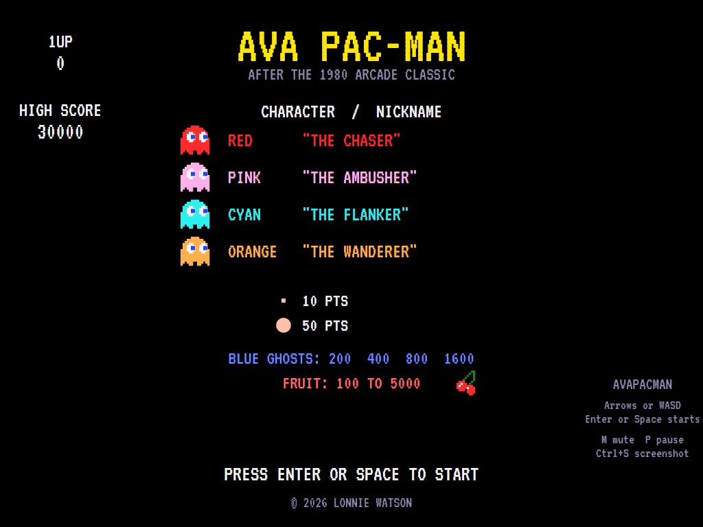
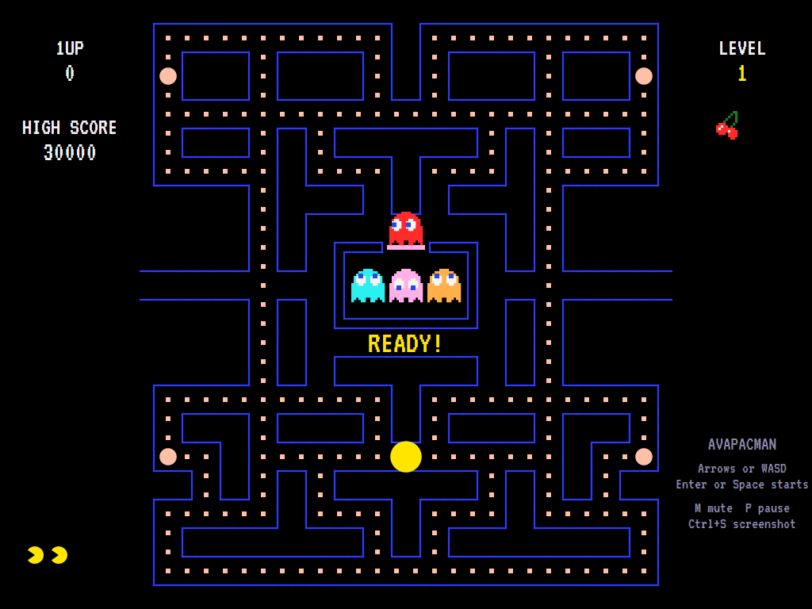
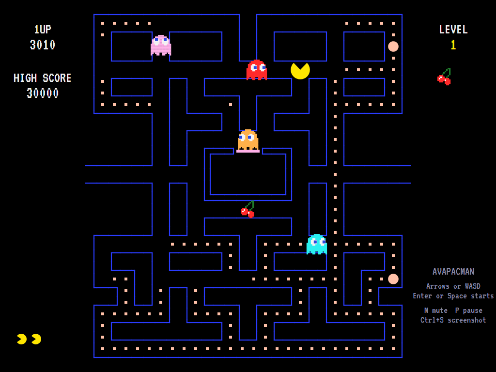
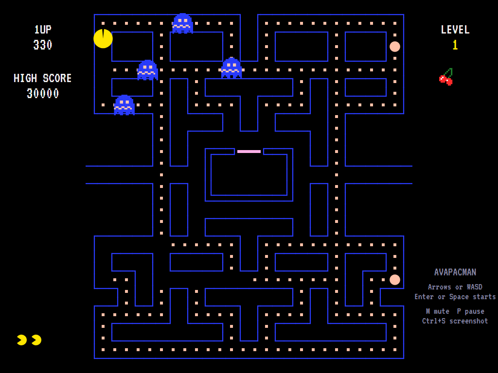
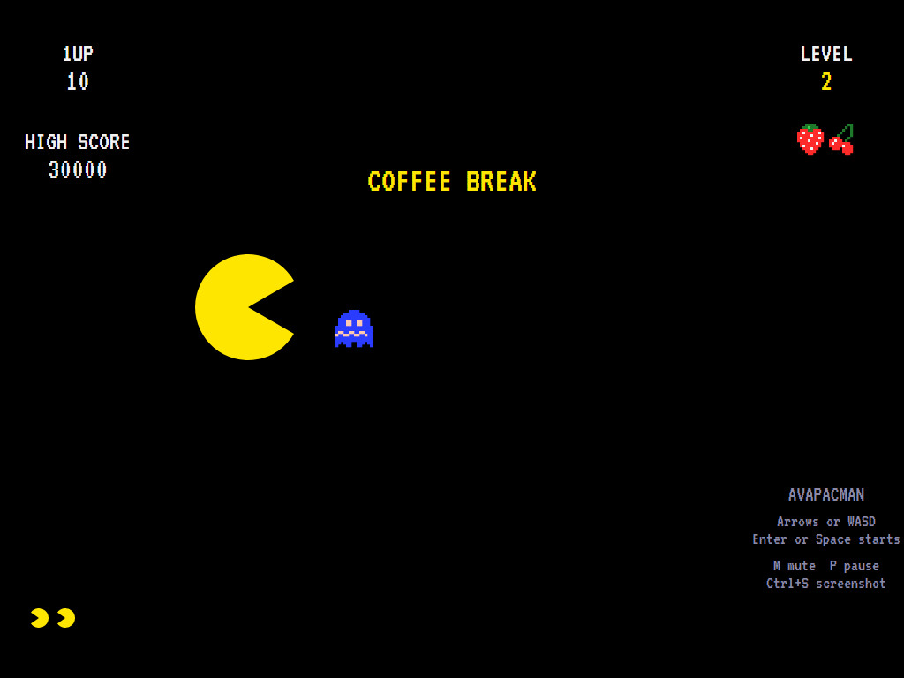
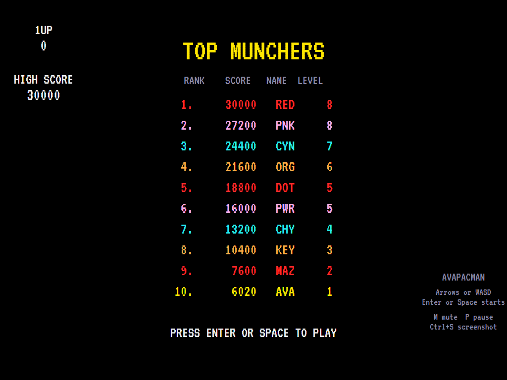

# AVAPacMan

[](https://github.com/Harlock123/AVAPacMan/actions/workflows/build.yml)

A maze-chase game in the style of Namco's 1980 arcade game **Pac-Man**, built with .NET 10 and
Avalonia UI. Eat every dot in the maze while four ghosts hunt you, each in its own way. Eat an energizer
and the tables turn: for a few seconds the ghosts go blue and you can eat them, each worth twice as much
as the last.

## Features

- **An original maze**: the arcade's size (28 by 31 tiles), with a tunnel at each side and the ghosts'
  house in the middle, but with this game's own layout.
- **Four ghosts with four minds**:
  - **Red** chases you directly, and speeds up as the dots run out.
  - **Pink** aims four tiles ahead of you.
  - **Cyan** works with red to cut you off.
  - **Orange** chases from far away but wanders off when close.
  
  They take turns to **scatter** to their corners and **chase**, on the arcade's timetable, and turn
  round at every change. They never turn back on their own, and they slow down in the tunnel.
- **The ghost house**: ghosts come out on a count of the dots you eat, or when you stop eating for a
  few seconds. Eaten ghosts' eyes hurry home and come back out.
- **Energizers**: the ghosts turn blue and run. Eaten ghosts are worth **200, 400, 800 and 1600**.
  They flash white when they're about to recover. The fright gets shorter on later levels, and from
  level 19 an energizer only turns them round.
- **Fruit** appears twice a level, from a cherry worth 100 to a key worth 5000.
- **Levels** get faster, with the maze flashing at the end of each one, and there's a short
  **coffee-break** scene after levels 2, 5 and 9, then every four levels.
- **Sound**: a siren that rises as the dots run out, the frightened warble, the eyes' whoosh, the
  two-note chomp, and original tunes for the title, the start and the coffee break, all mixed by OpenAL.
- **Attract mode**: leave the title alone for 15 seconds and a computer player plays a demonstration,
  with all its sounds.
- **Three lives**, a bonus life at 10,000, and a **top-ten high-score table** with arcade-style
  initials entry.
- **Any window size**: the screen scales to fit, letterboxed. **Ctrl+S** saves a screenshot.
- **One self-contained executable** per platform: Windows, macOS and Linux on Intel/AMD and ARM.

The maze, sprites, sounds and tunes are all this game's own.

## Screenshots

| Title screen | Ready | In play |
|:------------:|:-----:|:-------:|
|  |  |  |
| The ghosts and what everything is worth. | The start of a game. | Ghosts out, cherry showing. |

| Frightened | Coffee break | The high-score table |
|:----------:|:------------:|:--------------------:|
|  |  |  |
| An energizer eaten: the ghosts run. | After level 2, the chase turns round. | The new entry flashes in the table. |

The screenshots are made by the tests, which play the game in a real (headless) window; see
[Tests](#tests).

## Download and run

Ready-to-run builds for Windows, macOS and Linux, on both Intel/AMD and ARM, are on the
[Releases page](https://github.com/Harlock123/AVAPacMan/releases/tag/latest). **Latest build** is
rebuilt on every push to `main`. Each download is one self-contained executable: no .NET install is
needed.

| Platform | Archive |
|---|---|
| Windows | `AVAPacMan-win-x64.zip`, `AVAPacMan-win-x86.zip`, `AVAPacMan-win-arm64.zip` |
| macOS | `AVAPacMan-osx-arm64.tar.gz` (Apple silicon), `AVAPacMan-osx-x64.tar.gz` (Intel) |
| Linux | `AVAPacMan-linux-x64.tar.gz`, `AVAPacMan-linux-arm64.tar.gz`, `AVAPacMan-linux-arm.tar.gz` |

```bash
tar -xzf AVAPacMan-linux-x64.tar.gz     # or linux-arm64, linux-arm, osx-arm64, osx-x64
./AVAPacMan
```

On Windows, unzip and run `AVAPacMan.exe`. On macOS, if Gatekeeper refuses to open it, run
`xattr -d com.apple.quarantine AVAPacMan` once. Run with `--no-audio` for silence.

**Sound** comes through OpenAL Soft, built in for every platform. In a virtual machine the game
detects it and uses a larger audio buffer, so the sound doesn't break up.

**Gamepads** use SDL2, which is bundled for Windows, macOS and Intel/AMD Linux. ARM Linux builds need it
installed; without it the keyboard still works:

```bash
sudo apt install libsdl2-dev            # Debian / Ubuntu / Raspberry Pi OS
sudo pacman -S --needed sdl2-compat     # Arch / Omarchy
```

## Controls

| Input | Action |
|-------|--------|
| **Arrow keys** / **WASD** | Steer (press a turn early and it's taken at the next opening) |
| **Enter** / **Space** | Start a game |
| **P** / **Esc** | Pause (Esc again to quit) |
| **M** | Mute |
| **Ctrl+S** / **Cmd+S** | Save a screenshot to the Pictures folder |

**Gamepad**: the left stick or D-pad steers, **Start** or **A** starts, **Start** pauses, **Back** (while
paused) quits.

**Entering initials**: type letters, or dial with **Up**/**Down** and accept with **Space**; **Left** /
**Backspace** go back; **Enter** finishes.

## Scoring

| Target | Points |
|---|---:|
| Dot | 10 |
| Energizer | 50 |
| Blue ghosts, one after another | 200, 400, 800, 1600 |
| Cherry, strawberry, orange, apple | 100, 300, 500, 700 |
| Melon, rocket, bell, key | 1000, 2000, 3000, 5000 |

## Tests

```bash
dotnet test AVAPacMan.slnx
```

The engine has no UI and runs in fixed 60 Hz steps, so it plays the same at any frame rate, and a seed
always plays the same game. The tests check:

- the maze: no dead ends, one-wide corridors, every dot reachable;
- steering, turning early and turning round, the tunnel, and dots and energizers;
- each ghost's target, scattering and chasing on the timetable (and turning round at each change), and
  ghosts never turning back on their own;
- leaving the house by dot count or idle time;
- fright, eating ghosts and their eyes going home, being caught, fruit, clearing a level, the coffee
  break, faster levels and shorter frights, red speeding up, and the bonus life;
- the title tune, the demonstration's sound, pausing the siren, and every sound and sprite.

A computer player (the attract-mode one) plays whole games in them and must clear the first maze.

The screenshot tests draw the real screen in a headless window. To refresh the README's pictures:

```bash
PACMAN_SHOTS=$PWD/Images dotnet test tests/AVAPacMan.Tests --filter ScreenshotTests
```

## Building

```bash
dotnet build AVAPacMan.slnx
dotnet run --project src/AVAPacMan
```

Needs the .NET 10 SDK. The sounds are made by `tools/make_sounds.py` (standard-library Python):
`python3 tools/make_sounds.py` rewrites `src/AVAPacMan/Sounds`.

## Project structure

```
AVAPacMan/
├── AVAPacMan.slnx
├── src/AVAPacMan/
│   ├── Engine/
│   │   ├── GameEngine.cs        # States, scoring, the bonus life and the background sound
│   │   ├── GameEngine.Play.cs   # Moving through the maze, the ghosts' minds, the house, fright,
│   │   │                        # fruit, being caught, and clearing levels
│   │   ├── Entities.cs          # The player and the ghosts
│   │   ├── AttractPilot.cs      # The computer player for the demonstration (and the tests)
│   │   ├── HighScoreTable.cs, InitialsEntry.cs
│   │   ├── InputHandler.cs, ControllerManager.cs  # Keys and an SDL2 gamepad
│   │   └── SoundManager.cs      # Effects, tunes and the siren through OpenAL
│   ├── Audio/                   # The OpenAL engine (from the author's AVABand)
│   ├── Models/                  # The maze, the levels' timings and prizes, and the pixel art
│   ├── Views/                   # The screen: maze, ghosts, player, panels, title and tables
│   └── Sounds/                  # The synthesised effects and tunes
├── tests/AVAPacMan.Tests/       # Gameplay and screenshot tests
├── tools/make_sounds.py
└── Images/                      # Screenshots
```

## About and licence

AVAPacMan © 2026 Lonnie Watson, under the [MIT License](LICENSE).

*Pac-Man* © 1980 Namco (Bandai Namco Entertainment); the name belongs to its owner. AVAPacMan is an
independent, unofficial game in its style. Its maze, sprites, sounds, tunes and code are its own; nothing
is taken from the arcade machine's program, graphics or sound. It is not affiliated with or endorsed by
any rights holder.

Bundled components keep their own licences: the VT323 font (SIL Open Font License 1.1, by Peter Hull;
`src/AVAPacMan/Assets/Fonts/VT323-OFL.txt`), OpenAL Soft (LGPL-2.0-or-later; loaded as a separate
library; `src/AVAPacMan/Audio/native/COPYING-openal-soft.txt`), and the MIT-licensed Avalonia,
Silk.NET, NVorbis, NLayer and SDL2-CS (with SDL2 under the zlib licence).
